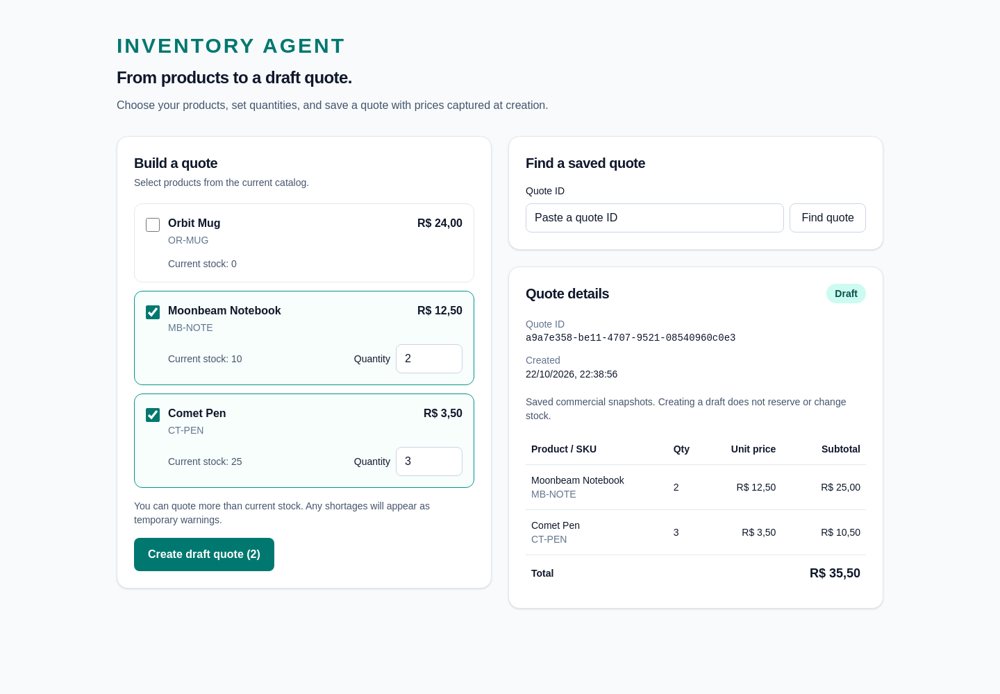
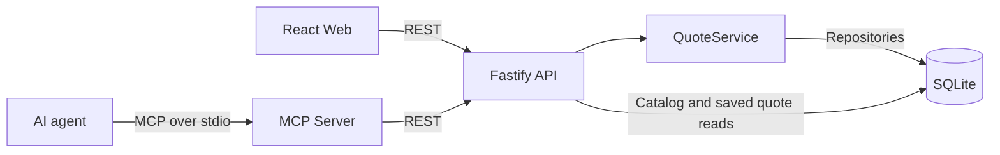

# Inventory Agent

Inventory Agent lets an AI agent discover catalog products, observe stock, and save draft quotes through four MCP tools. A React web interface supports the same quoting workflow. Both clients use one REST API, so quantities, prices, persistence, and stock warnings follow the same business rules.

A quote captures commercial terms; it does not reserve stock, guarantee availability, or confirm a sale. This is a local MVP with a fictional catalog.



## Demo

In an [observed manual agent run](docs/evaluation/first-manual-results.md), the agent called `search_products` twice, then `create_quote`, and saved this draft:

| Product | Quantity | Unit price | Subtotal |
| --- | ---: | ---: | ---: |
| Moonbeam Notebook | 2 | BRL 12.50 | BRL 25.00 |
| Comet Pen | 3 | BRL 3.50 | BRL 10.50 |
| **Total** | | | **BRL 35.50** |

The agent explicitly stated that no stock was reserved and no sale confirmed. This run used the development environment; saved-quote retrieval was not supplied as evidence.

## Architecture



`packages/core` owns draft creation, duplicate aggregation, price calculations, snapshots, and stock warnings. `apps/api` provides validation, HTTP routes, and SQLite repositories. `apps/web` uses React, Vite, and Tailwind CSS; `apps/mcp` uses the MCP TypeScript SDK and Zod schemas.

The MCP server reuses the REST API instead of accessing SQLite or duplicating business rules. This keeps web and agent quote creation consistent and lets the MCP layer focus on tool contracts, response validation, and actionable errors.

## Features

The web interface displays the catalog and current stock, creates drafts, and retrieves saved quotes by ID. The MCP server exposes:

| Tool | Input | Behavior |
| --- | --- | --- |
| `search_products` | `{ "query": "pen" }` | Returns all case-insensitive name/SKU substring matches with exact IDs, prices in BRL cents, and observed stock. An empty result means no match. |
| `check_stock` | `{ "productId": "pen" }` | Returns current observed stock for an exact catalog ID. |
| `create_quote` | `{ "items": [{ "productId": "pen", "quantity": 2 }] }` | Saves a draft and returns commercial snapshots, total, temporary stock warnings, and an availability notice. |
| `get_quote` | `{ "quoteId": "QUOTE_ID" }` | Returns saved commercial snapshots under `quote`, without stock or historical warnings. |

Agents should resolve products through search and ask for clarification when matches are ambiguous. Read tools are annotated read-only and idempotent. Successful tool calls return both structured content and a JSON text representation; failures return tool errors.

**`create_quote` is non-idempotent:** every successful call creates another draft. A failed or timed-out network request may already have committed. Do not automatically retry an uncertain creation outcome; inspect API logs before retrying.

## Quick Start

Use Node.js 22+ and run commands from the repository root. The SQLite native addon may require a C++ build toolchain if a prebuilt binary is unavailable.

```sh
npm install
npm run dev:api
```

In a second terminal:

```sh
npm run dev:web
```

The API defaults to `http://127.0.0.1:3000`. Open the frontend URL printed by Vite, normally `http://localhost:5173`. Select products, enter positive whole-number quantities, and create a draft. Use its ID in “Find a saved quote” to retrieve it later.

Vite proxies `/products` and `/quotes` to the API. If you change the API port, update both targets in `apps/web/vite.config.ts`. `npm run dev` is an alias for the API only. For an API process without watching, use `npm start --workspace @inventory-agent/api`.

## MCP Setup

Keep the API running separately. Launch the Inspector from the repository root:

```sh
npm run inspect:mcp
```

Connect over stdio and open Tools to inspect or call the four tools. For a direct stdio server process:

```sh
npm run start:mcp --silent
```

The silent flag suppresses npm banners on protocol stdout; diagnostics go to stderr. `npm run dev:mcp --silent` enables watching.

For an MCP client that accepts `mcpServers` configuration, use this entry and replace the checkout path (and Node executable if needed):

```json
{
  "mcpServers": {
    "inventory-agent": {
      "command": "node",
      "args": ["--import", "tsx", "/absolute/path/inventory-agent/apps/mcp/src/index.ts"],
      "cwd": "/absolute/path/inventory-agent",
      "env": { "INVENTORY_API_BASE_URL": "http://127.0.0.1:3000" }
    }
  }
}
```

The host launches its own MCP process. MCP configuration format and location depend on the client. Requests to the API time out after 10 seconds; input and API response contracts are validated with Zod.

## Testing & Evaluations

```sh
npm test
npm run typecheck
npm run build:web
```

Tests and typechecking include all workspaces. Core tests exercise quote rules; API tests use Fastify injection with isolated SQLite databases to check validation, atomic rollback, snapshots, warnings, and restart persistence. Web tests use mocked HTTP responses with Vitest, jsdom, and Testing Library. MCP tests cover schemas, annotations, results, and errors through an SDK client, mocked HTTP responses, and a real subprocess stdio handshake. The web build produces `apps/web/dist`.

The [first manual agent results](docs/evaluation/first-manual-results.md) record these supplied PASS assessments:

| Scenario | Observed behavior | Environment |
| --- | --- | --- |
| Normal quote | 2 notebooks + 3 pens; BRL 35.50 draft, with no-reservation/no-sale explanation. | Development |
| Insufficient stock | 2 mugs; BRL 48.00 draft; reported 2 requested, 0 available, and uncertain availability. | Development |
| Ambiguous product | Asked before choosing latex or nitrile; after “Latex”, saved 3 glove boxes for BRL 96.00. | Isolated evaluation |
| Nonexistent product | Reported no N95/3M match and requested another name or SKU; no quote creation reported. | Isolated evaluation |
| API unavailable | Search returned a connection error; agent reported it could not consult the catalog or create a quote, without using shell commands. | Isolated evaluation |

**Each scenario was observed once.** Some runs differed from the [documented evaluation protocol](docs/evaluation/README.md), including mug quantity, nonexistent product, and the glove clarification follow-up. Normal-quote retrieval evidence was not supplied. The nonexistent-product assessment is based on the response; its full tool trace was unavailable. These observations do not establish statistical reliability or comprehensive coverage and are not automated model evaluations.

For repeatable manual runs, `npm run eval:setup --silent` creates a fresh temporary SQLite database with the base catalog and two glove alternatives, prints its absolute path, and leaves the development database untouched. Follow the [evaluation guide](docs/evaluation/README.md) for isolated API/MCP startup and fault setup, and capture evidence with the [results template](docs/evaluation/results-template.md). Fixture tests verify setup and isolation, not agent behavior.

## Technical Details

### REST contracts

| Endpoint | Response |
| --- | --- |
| `GET /products` | Product array: `id`, `name`, `sku`, `unitPriceCents`, `stock`. Search filtering happens in MCP. |
| `POST /quotes` | HTTP 201 with `{ "quote": {...}, "warnings": [...] }`. Accepts only `items` containing `productId` and `quantity`. |
| `GET /quotes/:id` | The saved quote directly, without the MCP wrapper, stock, or warnings. |

A quote contains `id`, `status: "draft"`, `createdAt` as a UTC ISO 8601 string, `items`, and `totalCents`. Each item stores `productId`, `name`, `sku`, `quantity`, `unitPriceCents`, and `subtotalCents`.

JSON validation rejects extra fields (including client prices), empty item arrays, blank IDs, and quantities that are not positive safe integers. Duplicate IDs are combined; unsafe combined quantities or amounts return HTTP 400. Missing products or quotes return 404, unsupported content types return 415, and unexpected failures return a generic 500. Errors use `{ "error": "..." }`. Monetary calculations use integer BRL cents.

### Snapshots and availability

Product names, SKUs, and prices are snapshotted so a saved quote retains its original commercial terms even if the catalog changes or a product is deleted. Stock warnings describe an observation at creation time, so they are transient rather than stored as a lasting availability claim.

Insufficient stock still permits a draft. The creation response includes `INSUFFICIENT_STOCK` warnings with `productId`, `requestedQuantity`, and `availableStock`. Retrieval cannot recover those warnings or historical stock. Draft creation never changes stock.

### Configuration and persistence

| Variable | Process | Default |
| --- | --- | --- |
| `HOST` | API | `127.0.0.1` |
| `PORT` | API | `3000` |
| `DATABASE_PATH` | API | `./data/inventory.sqlite`, relative to the API working directory |
| `INVENTORY_API_BASE_URL` | MCP | `http://127.0.0.1:3000` |

With npm workspace scripts, the default database is `apps/api/data/inventory.sqlite`. Parent directories are created automatically. Set variables in the relevant process; setting `DATABASE_PATH` on MCP does not select the API database. The MCP URL must use HTTP(S) without a query or fragment.

SQLite uses WAL mode, foreign keys, and strict tables. Transactional initialization creates schema version 1 (`PRAGMA user_version`) and seeds Moonbeam Notebook, Comet Pen, and Orbit Mug. Reopening preserves data without reseeding. Quote and item inserts commit or roll back together. Local database files are ignored by Git.

`QuoteService` depends on repository interfaces and injected ID/clock functions. `buildApp` accepts a caller-owned database connection, allowing route tests without opening a listening port; the API entrypoint owns connection shutdown.

## Limitations

This is a local-only MVP without authentication, remote hosting, payment processing, stock reservation, or sale confirmation. It has no product-editing interface. Stock observations do not guarantee future availability, and draft creation has no idempotency key.

The Vite proxy is development-only. A web bundle alone does not provide a hosted application; any future hosting setup must route `/products` and `/quotes` to the API separately.
